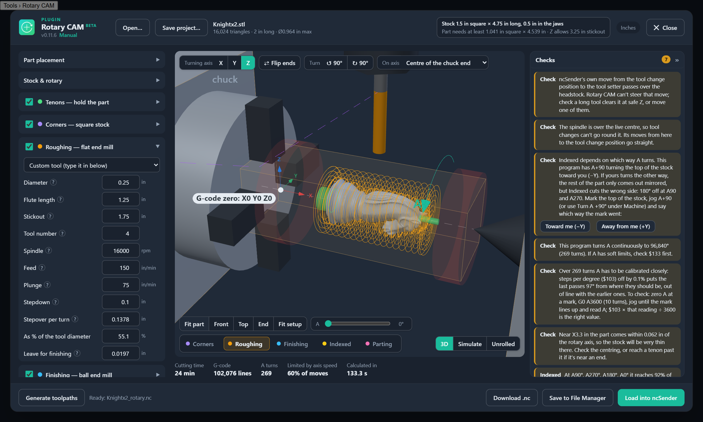
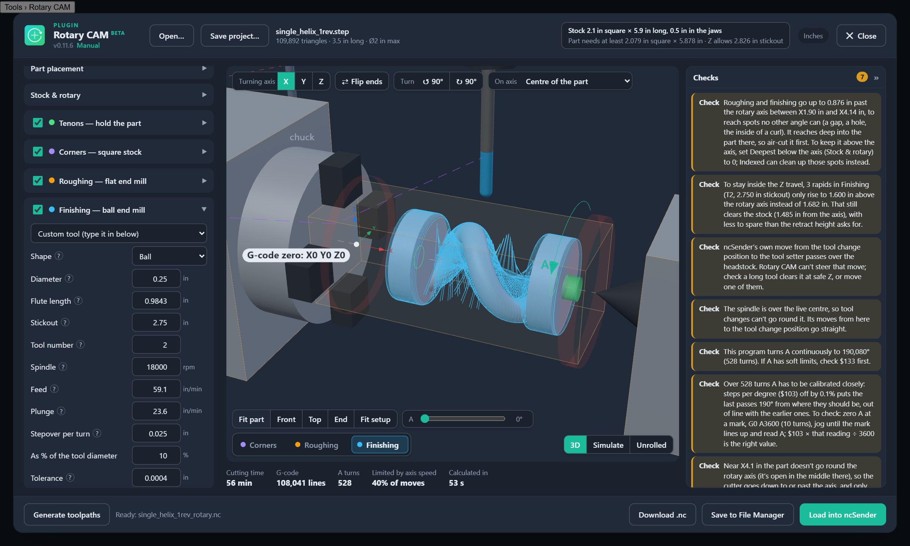
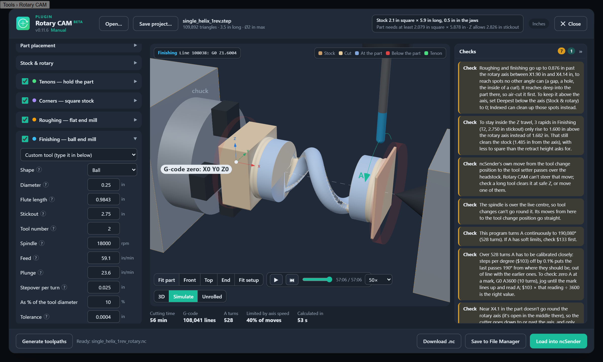

# Rotary CAM (ncSender plugin)

Simultaneous 4th-axis rotary CAM inside ncSender. Open an STL or STEP part, rough it
with a flat end mill in spiral layers, finish it with one continuous spiral (ball, flat or tapered ball end mill),
clean up under overhangs with indexed (3+1) passes, and simulate the program against
the stock, then load the G-code straight into ncSender. This is the X/Z/A
wrapping-around kind of rotary work that Fusion keeps behind the Machining Extension.



*A knight in 1½ in square stock: the roughing spiral (orange) wraps the part, the chuck,
tailstock and spindle are drawn to scale, and beside them are the checks Rotary CAM runs
on every program before you cut.*

<p align="center"> </p>

*Parts open down the middle: on this helix, roughing and finishing go past the rotary axis
to clear the inside of the coil (left), and Simulate shows it carved, open all the way
through (right).*

**New to it? Start with [MANUAL.md](MANUAL.md):** setting up the controller and the rotary, and what to check before the first carve.

## ⚠️ The fine print (worth the 30 seconds)

Rotary CAM is **beta software**. A hobbyist wrote it for his own machine and shares it in case it helps with yours. It writes G-code that swings a spinning cutter around a spinning part. When everything's right, that's magic. When something's wrong, it's a broken bit, a ruined part, a crashed rotary, or worse.

- **You're the machinist.** Rotary CAM is a tool, not a supervisor. Check every program before you run it: simulate it, read the warnings, and air-cut the first one on any new setup. Check that zero is on the axis, A turns the way the plugin thinks, and nothing is in the cutter's way.
- **Safety is on you.** Use solid workholding and eye and hearing protection, keep a hand near the E-stop, and don't leave a running machine alone.
- **No warranty, none at all.** It's provided "as is" under the MIT License, without warranty of any kind, including that it works or suits your purpose. It has bugs; some have been found the exciting way, and some are surely still waiting.
- **No liability.** The author and contributors aren't liable for any damage, loss or injury from using it: to your machine, tooling, stock, shop, wallet or self. Whoever presses Cycle Start owns what happens next.
- **Not official.** It's an independent plugin, not made, endorsed or supported by ncSender, Sienci Labs or your machine's maker.

By installing or using Rotary CAM, you accept all of the above. Now go make chips, carefully. 🙂

## Install

- **ncSender › Settings › Plugins**: find **Rotary CAM** in the plugin list and install it.
- Or download `com.cncdocs.rotary-cam_vX.Y.Z.zip` from
  [Releases](https://github.com/stmoha/ncsender-plugin-rotary-cam/releases/latest) and use
  **Install Plugin** in the same place.
- Then open it from **Tools › Rotary CAM**. Updates show as **Update available** on the
  plugin's card in Settings › Plugins (and as a badge in Rotary CAM's header).

Needs ncSender 2.0.88 or later (Pro 2.0.149), grblHAL, and a rotary A axis parallel to X.

## Setup it assumes

- A rotates about X. Chuck on the left (−X), tailstock on the right (+X).
- **Work zero: X0 = chuck jaw face, Y0 and Z0 = rotary centreline.** Z in the program is
  the tool-tip radius, so Z0 must be the axis, not the top of the stock. The 3D view marks
  it (*G-code zero: X0 Y0 Z0*), drawn through the stock since it's inside it. **Work zero —
  from a corner of the rotary** sets it from a corner you can touch off (below).
- Y stays at 0 for the rotary passes (Corners and Indexed move in Y with A locked).
- The rotary passes keep the tool tip above the axis, except where a spot can only be
  reached by going past it (see **Deepest below the axis** under Stock & rotary).
- With **Tool changes › Go round the rotary** on (the default once ncSender says where things
  are), start the job with the spindle over the rotary, where you set X0 Y0: the program
  goes up to ncSender's Safe Z and over the part before its first tool change.

Check the A direction once: mark the top of the stock and jog A+90. Set
*A+90 moves the top of the stock to* to wherever the mark went (−Y or +Y). Getting this
wrong mirrors anything asymmetric.

## Using it

1. **Tools › Rotary CAM** opens a full-window view of the rotary setup: chuck (4 jaws, or
   3), stock, tailstock, the rotary axis and the G-code zero. The version shows under the
   name, beside a **Manual** link (opens [MANUAL.md](MANUAL.md) in a new tab), with a pulsing badge when ncSender finds a newer release (its card links to what's
   new, opens ncSender's plugin settings, or updates it there and then). The header always
   shows the stock: what's set, the least the part needs (across and from the jaws to the
   centre), and the room Z has above the axis, in red when something's short; click it for
   Stock & rotary. The collet nut and spindle go
   see-through when they'd hide the part (looking down from the top, say). The first time
   it opens it shows the fine print (above) until you click **I understand**; click **beta**
   next to the name to read it again. **Open…** (or drop) a `.stl`, `.step` or `.stp`
   part, or a Rotary CAM project (`.rcam`, below).
2. **Place the part** with the buttons on the 3D view:
   - **Turning axis X / Y / Z:** which model axis lies along the rotary. A new file starts
     on its longest side.
   - **Flip ends:** which end goes in the chuck.
   - **Turn ↺ / ↻ 90°**, or **click the part**: turns it about the rotary axis so the side
     you clicked faces up at A0.
   - **On axis:** what sits on the rotary centreline: the centre of the part, the centre
     of its chuck end (a chess piece's round base), the tailstock end, or the model origin.
   - **A slider:** turns the part and its stock the way the rotary will.
   - **Part starts at X** (Part placement): from the jaw face (X0) to where the work
     starts: the chuck end tenon first, then the part. A longer tenon
     moves the part along, so you set this once. Keep it at least **Keep away from the
     jaws**, or the tools can't cut all of the tenon; the check that says so has a
     **Set Part starts at X to …** button. Settings from before 0.11.5 are converted so the
     part stays where it was.
   - **Scale** (Part placement): the part's size against the model as drawn (100%). A model
     drawn in inches but read as millimetres needs 2540%. **Scale to fit the stock** picks
     the largest size that fits the stock with 1 mm to spare all round and fits between
     where the part starts and the tailstock, leaving the tailstock end tenon's length (or
     the tools' room) and the keep-away; the message says what set the size and where each
     end is. If Part starts at X is inside the keep-away from the jaws, it moves out to it.
     A part too big for the stock offers **Set Stock width / Stock diameter to …** and
     **Scale the part to fit**; stock too short offers **Set Stock length to …**.
   - Settings in the side panel update the 3D view as you type or use the arrow keys.
3. **Stock & rotary:** round, square or rectangular stock, its **Stock length** (the whole
   piece, the end in the jaws included) and **Clamping distance** (how far it goes into the
   jaws past the jaw face, 1/2" to start), keep-away distances. The live centre is at the
   stock length less the clamping distance from the jaw face; changing the clamping
   distance keeps the stock length, so the centre moves. The 3D stock goes into the jaws by
   the clamping distance. If the part doesn't fit, it turns red. **Size the stock to fit the
   part** (bottom of the section) is the other way round from Scale to fit the stock: the
   part keeps its size and the stock is set for it, 1 mm to spare all round (rounded up to
   a whole mm, or a tenth of an inch) and long enough for the part, the tailstock end tenon
   (or the tools' room) and the keep-away from the tailstock. The clamping distance stays.
   **Deepest below the axis:** how far roughing and finishing may take the tool tip past the
   rotary axis. Most of the part is reached from above the axis, half a turn round, so the
   tool only goes past it where nothing else gets there: the middle of a slot or hole right
   through the part (a ball goes one radius past, so no thin web is left on the axis), the
   bottom of a hole that goes past the axis, the inside of a curl. Empty (auto) goes there,
   only as deep as each spot needs; a number is the most it may go; 0 keeps the tool above
   the axis everywhere (Indexed can clean up those spots instead). After Generate a message
   says how deep and where. Where nothing of the part is under the tool at all (looking
   straight through a slot), roughing and finishing now cut down to the axis instead of
   leaving the stock there.
4. **Tenons** (on by default): a solid round stub on the rotary axis at each end of the
   part, so it stays joined to the stock while it's carved. Each one reaches a set depth
   into the part and runs out to the uncut stock past the end. Nothing cuts into a tenon;
   **Parting** cuts each one down to its diameter at the end, ready to cut the part free.
   Trim the stubs off the part afterwards.
   - **Ends:** both, chuck end only, or tailstock end only.
   - **Same at both ends** (default, Ø1/2" × 1/4" deep): untick it to give each end its own
     diameter and depth, for example a thin tenon into a small nose and a bigger one into
     the base.
   - **Length out of the part:** how long each tenon is between the part and the rest of
     the stock, which stays full size. Empty (*auto*) is just the room the tools need to
     reach the end of the part (with Parting on, at least one parting cutter); set it for a
     longer stub to saw through. Without Parting, roughing takes the whole length down to
     the tenon's diameter; with Parting on, roughing leaves it thick past the tools' room
     (the part stays held firmly while it's carved) and Parting cuts it down last. A long
     one at the chuck end brings the
     collet nut near the chuck: it stays up there and says so if it would hit.
   - Reach the tenon past any thin or off-centre spot near the end (a chess knight's nose);
     otherwise only that spot holds the part. The tenons show green in the 3D view, the
     side profile and the simulation.
5. **Operations**, in the order they run (each can be ticked off):
   - **Corners** (square and rectangular stock only): locks A with each corner up and faces
     it flat with straight X passes, stepping in Y (3+1), turning the square into an
     octagon. Roughing then starts from the octagon, so it spends far less time in air.
     It can use a bigger end mill than roughing; the same tool number means no tool change.
   - **Roughing:** flat end mill, spiral layers, leaving an allowance for finishing.
   - **Finishing:** one continuous spiral, with extra points on sharp features.
     Finishing and Indexed take any end mill (Shape): a **ball** for smooth curves, a
     **flat end mill** for flat faces, square shoulders and corners (on curves it leaves
     small steps, so use a fine stepover; the Tool list has the library's flat end mills too,
     and finishing with the roughing tool's number and size needs no tool change), or a
     **tapered ball**: a small ball tip on
     a cone that widens to the shank, for fine detail. Set its tip diameter, taper per side
     and shank diameter here; ncSender's Tool Library doesn't store those yet, so a tapered
     ball kept there as a V-bit can be picked and its diameter is taken as the shank. The
     tool's whole shape is kept off the part (a vertical face lifts the cone before the tip
     can reach it), the stock past what roughing cut is treated as a wall the cone can't run
     into, roughing clears a little further past the ends to make room, and the keep-away
     distances from the chuck and tailstock are measured from the shank.
   - **Indexed** (off until you tick it): finishes what the rotary passes couldn't reach.
     It plays the program to the end of finishing to see what's left on the part:
     material hidden under the part from every line through the axis (under a chin or a
     jaw), and, if you want, creases the finishing ball was too big for. It locks A at each
     of the **A angles** you list (90, 270 to start with) and runs 3-axis passes over just
     those patches: the tool
     offset in Y so it comes in beside the overhang, in layers where a lot is left, each
     patch run its long way with linked passes. The tool always points across the rotary
     axis on this machine, so a pocket that only opens toward the chuck or tailstock can't
     be reached; the message after Generate says how much was reached and where the rest is.
     Each angle is checked just before it's planned, against what the angles before it left.
     **Finish the whole side it faces** (off by default): after that clean-up, each angle
     also runs one even finishing pass over the whole side of the part it faces, line by
     line along the part a stepover apart, the tool riding the surface like a 3-axis
     parallel finish, wherever the surface is no steeper across the passes than 55° (the
     next angle round does the steeper parts), the collet nut and spindle clear, inside
     the keep-aways. Clean-up alone goes only where material is left, which on a detailed
     part is many small spots, each its own plunge and hop: a stippled look. The whole side
     gives one even surface, at the cost of time (roughly doubling the cutting time on the
     chess knight). Anything thick still there under the side pass is taken down in layers
     first. It only goes where the ball itself touches the part: beside the part a tapered
     ball's cone can rest on the part's side with the tip far below it, and those spots are
     left out (as is anything below the part's own outline).
     **Pick the angles for me** (off by default) tries A every 15° first and picks the fewest
     angles that reach the most, at most *Most angles* of them. It takes much longer, since
     all 24 are tried before any is planned (on a detailed part, minutes rather than seconds),
     and says so when you tick it. It tries them on a coarser grid (0.6 mm, or half the
     ball's radius) to rank them, then looks at the ones it picks as finely as listed angles.
     **Speed:** a plain ball is dropped onto the part by Rotary CAM's own exact drop-cutter,
     the same contact maths as OpenCAMLib (it agrees with it to well under a micron) with the
     part kept in a grid for each angle, 8 to 15 times faster; a flat end mill or a tapered
     ball still goes through OpenCAMLib. The drops are shared out over all the workers (all the cores but
     one, up to 8), and the checks for
     the collet nut and spindle only look where they're needed. On the chess knight that
     took Indexed from over two minutes to around 20 seconds on one core.
     **Angles in 3D:** with Indexed showing (its button on the view, or any of its settings),
     each angle shows as a see-through Indexed tool coming straight down onto the part the
     way it will with A locked there; once generated, what the rotary passes leave shows as
     yellow blocks. Click an angle's chip (A90°, under *A angles*) to turn the part to it:
     its tool points straight down and the part goes light where that tool can see and dark
     slate where it can't (the dark faces are out of its reach). Drag a tool around the axis
     in the 3D view to change its angle (5° steps, Shift for 1°), ✕ removes one, and **+ A**
     adds the angle the A slider is at: turn the part until the spot you want faces straight
     up, then press it. Changing the angles the calculation picked makes them your own.
   - **Parting:** after finishing, cuts each tenon down to its diameter along its whole
     length (spiralling in), ready to cut the part free. The tenons set where and how thin
     (Tenons: ends, diameter, length), so Parting only has its tool, feeds and depth per
     turn, and needs Tenons on. Off until you tick it.
   Toolpaths reach the ends of the part: the cutter runs past an end until its contact
   point gets there, as long as that end goes all the way round the rotary axis (a tenon
   does). An end that sits off to one side with no tenon keeps the whole cutter over the
   part, so the tool never drops down beside the part and cuts through the stock holding it.
6. **Generate toolpaths.** The **Corners / Roughing / Finishing / Parting** buttons on the
   view pick which tool and toolpath to show, each in its own colour. **Checks** (what to
   fix in red, what to check in amber, how Indexed did in green) show under the view on a
   portrait screen or a narrow window. On a wide landscape screen (1200 px or more) they get
   a column of their own right of the view, so the view keeps its height; click its header
   to shut it to a strip that still counts them (remembered in that browser). Notices of
   what just happened (saved, picked up a change) float over the view there.
7. **Simulate** plays the program itself, line by line, against a model of the stock: play,
   pause, drag to any point, and 1× to 1000× speed, with the current line and operation
   shown. The whole program is checked first: rapids that cut into the stock, anywhere
   the stock ends up below the part (red), any cut into a tenon, and the collet nut or
   spindle running into the stock or the chuck, headstock, live centre or tailstock. The
   tool shows with its nut and spindle. The result shows
   with the checks. From the start of Indexed the view shows the part inside a see-through
   stock, with what the rotary passes left as yellow blocks that disappear as Indexed
   cuts them; anything still yellow at the end is what nothing reached.
8. **Load into ncSender**, **Save to File Manager** (in `Rotary CAM/`) or **Download .nc**.
9. **Work zero — from a corner of the rotary:** for setting the zero after the rotary goes
   back on the table. Measure once, in machine coordinates, how far the work zero (jaw
   face, on the axis) is from a corner you can touch off, such as the top front corner of
   the headstock housing: **X, Y and Z, corner to the zero** (the zero minus the corner;
   for that corner X and Y are positive and Z negative). These are measured, separate from
   the headstock's keep-out box, which can stay generous. Then each time:
   1. Zero X, Y and Z on that corner with a touch block or 3D probe.
   2. Press **Move zero to the rotary axis**. It shows where the work offset goes, and on
      **Move it** sends `G10 L2` to add the offsets to the active work offset (G54 to G59),
      in mm for that one line and back to whatever units the controller was in, the way
      ncSender's own probe routines do. It checks the move landed and updates the rotary
      zero used for tool changes.
   It won't move it twice (it knows where it put it), or while the machine is running.
   Editing any of the three shows the corner in 3D, with arrows for the way to probe each
   face and the X, Y and Z legs to the zero dimensioned. **Remember axis** and **Remember
   corner** work the offsets out for you: zero on the axis the usual way and press
   Remember axis, then zero on the corner and press Remember corner. Changing them doesn't
   touch the toolpaths.
10. **Rotary & spindle — collisions:** the chuck (diameter with the jaws, length), the
   headstock behind it (housing, motor and drive), the live centre (its diameter, the
   length of its cone, and its **Total length** back to the tailstock body: the cone, then
   a round body at its diameter; empty, the cone goes straight into the body), the
   tailstock (body, lock lever and handwheel), the collet nut (diameter, length) and the
   spindle's diameter. In 3D the chuck, headstock, tailstock, live centre body and spindle
   are silver, the jaws, the live centre's cone and the collet nut dark gray. The chuck end
   or the tailstock end turns see-through when it's between you and the part (looking
   down the axis from either end, say), the way the collet nut and spindle do from the top.
   The headstock and tailstock needn't be centred on the axis: each has a length along X,
   a **Reach to the front (−Y)** and a **Reach to the back (+Y)** from the axis, and a
   **Top** above the axis. Each end is kept out as one box, so make it just big enough to
   take in the motor and pulley, or the lever and handwheel, without modelling each piece;
   setting the front and back separately means a motor behind the chuck or a lever out the
   back grows the box only on that side, not both. (0.7.0's single width carries over
   as half to each side.) Click into or hover over any setting and the 3D view lights up
   the part of the setup it's about, with a dimension line showing what the number
   measures; if that part is off the screen the view swings round to it. The same goes for
   the stock, the keep-aways, retract height, each tool's stickout, the part's start and
   placement, and the tool change, tool setter and rotary zero. Each tool's own sizes are
   dimensioned on it (diameter, flute length, a tapered ball's shank and taper), and the
   pass settings show at the tool with a see-through outline of where the next one goes:
   **Stepdown** (and Parting's depth per turn) as a slab one layer deep, **Stepover per
   turn** one turn along X, Indexed and Corners **Stepover** one pass across, and the
   **Leave** against the part. Those are a few mm across, so clicking into one closes the
   view in on the tool, and leaving the field puts it back (unless you've moved it).
   **Deepest below the axis** shows from the axis down at the tool (on auto, how deep the
   last program went), **Angle step** a spoke round the stock every step, and Stock shape
   and the tenon Ends light up what they change. **Stepovers** (Stepover per turn for
   roughing and finishing, Stepover for Corners and Indexed) can be typed as a length or as
   a % of the tool diameter in the box under each; the other follows. Typed as a %, it stays
   that % when you change the tool. Each operation's tool has a **Stickout**: how far it sticks out of the nut
   (from the Tool Library's stickout when it has one, otherwise its flutes plus a little).
   The 3D view draws all of it at size, the tool with its nut and spindle.
   Every operation keeps the whole tool, the nut and the spindle off the chuck, headstock,
   live centre and tailstock, and keeps the nut and spindle off the part, its tenons and
   the stock past what roughing cut, by **Keep the holder clear by** (2 mm). Where an
   operation would have to go lower than that allows, it stays up instead and says so,
   with the stickout that would let it reach (*Finishing stays up to 10 mm off what it
   would cut between X14 and X20: any lower and the collet nut would hit the chuck. Give
   the tool at least 38 mm stickout, or move the part further from the jaws*). Rapids
   travel high enough for the holder too. Indexed checks every pass against what's
   actually left (and the uncut stock past it), picks its angles where the nut and spindle
   fit, and says how much only a longer stickout would reach.
11. **Tool changes:** ncSender's Manual Tool Changer lifts to Safe Z and goes in straight
   lines to the tool change position and the tool setter, and back to where the M6 was.
   A straight line can pass over the rotary, and a long tool at Safe Z may not clear the
   chuck or tailstock. With **Go round the rotary** on, before each M6 the program goes up
   to Safe Z (`G53 G0 Z`) and round the rotary's footprint (grown by the spindle's radius;
   it never assumes the tool clears it) to the tool change position, issues the M6 there,
   and comes back the same way. ncSender's own moves are then only between the change
   position and the tool setter; if that line passes over the rotary it says so, since it
   can't steer that one. It needs to know where things are, in machine coordinates, and
   reads them from ncSender each time the dialog opens and before each Generate:
   - **Rotary zero:** the active work offset (G54) from the controller. The work zero is the
     jaw face on the axis, so that is where the rotary is.
   - **Tool change position and tool setter:** the Manual Tool Changer's settings.
   - **Safe Z:** ncSender's Settings.
   - **Top of Z above the axis:** how far above the rotary axis the tool tip is with Z at
     the top of its travel (machine Z0), from the work offset with the tool in the spindle,
     and the bottom of the travel from $132.
   - **Stickout of the tool in the spindle:** the tool whose length is in that work offset.
     Empty (*auto*), it's the stickout set here (or in the Tool Library) for the tool
     ncSender says is in, or else the first operation's tool; set it when that's wrong.
   - Type any of them in instead (another tool changer, ncSender not connected); a typed
     value is kept until **Read from ncSender**. The machine's travel limits keep the way
     round inside the machine.
   The 3D view (Fit setup) shows the tool change and tool setter, and the way round once
   generated.
   **Z travel:** ncSender checks a program against the machine's Z travel using the work
   offset when it's loaded, and flags anything above machine Z0. Rotary CAM keeps every
   move inside it: a tool that sticks out further than the one in the spindle has that much
   less room (its tip sits lower at the top of Z), so each operation gets its own limit.
   - The spindle nose sits the top of Z plus the spindle tool's stickout above the axis, so
     with this stock a tool can stick out so far and no further: the header shows it (*Z
     allows 1.667 in stickout*). If any tool sticks out more, Generate is off and one
     message says how far tools may stick out, which are too long and by how much, which
     tool it took to be in the spindle (and why), and how to check it on the machine: jog
     Z to the top, ncSender's Z reads the top of Z and the tip is that far above the axis.
     The tool in the spindle when the program is loaded has to be short enough too, since
     ncSender checks the whole program with it. A shorter stickout (zero Z again with it
     in), or smaller stock, fixes it.
   - Which tool is in the spindle, and so where the spindle nose is, is worked out when Z is
     read from the machine and kept until the machine changes (Z zeroed again, another
     tool): shortening stickouts in the settings is a plan for the next time a tool goes
     in, so the limit holds still while you do it. Once every operation fits, the message
     says what's left: put in the first tool, zero Z with it, and Generate again.
   - One tool number is one tool in one holder: a stickout or flute length set for one
     operation goes to every operation with that tool, and a tool picked from the Tool
     Library that another operation already uses comes in as set there. Two stickouts for
     one number (from older settings) stop Generate with a button for each; the same
     number for a different size or kind of tool does too.
   - It needs Z zeroed on the rotary axis and the machine homed. With Z0 still at the top of
     the travel (not zeroed on the axis yet), or the machine not homed, it isn't checked:
     the header says *zero Z on the rotary axis first* or *home the machine first*, Generate
     stays on, and the program carries a note. Zero Z on the axis, then generate (or press
     Read from ncSender) before loading.
   - Rapids that wanted to go higher than the travel allows are kept at the top of Z; if
     that still clears the stock, the message just says so. If the collet nut and spindle
     needed more room than that, or a cut would go below the bottom of the travel, it's a
     red *Danger* message.
12. **Save project…** keeps the whole job in one `.rcam` file; **Open…** brings it back:
   the part, every setting, the tools, and the G-code and toolpaths if they were generated,
   ready to simulate or load without calculating again. The rotary, spindle and tool change
   settings stay this machine's. (If ncSender's units, the axis rates, or the rotary,
   spindle or tool change differ from when it was saved, it says so and you generate again.
   A tool that's no longer in your Tool Library as saved keeps the project's own settings.)

### Project files (`.rcam`)

A `.rcam` is an ordinary ZIP archive; rename it `.zip` to look inside:

| File | What it is |
| --- | --- |
| `project.json` | format and version, the Rotary CAM version that saved it, units, the part's name, every setting (the same job settings ncSender stores for the plugin), the tools each operation uses with their Tool Library entries |
| `part.stl` | the part as Rotary CAM uses it, as drawn (before it's placed on the rotary), binary STL: opens in any CAD or slicer |
| `source/<name>.step` | the STEP file it came from, when the part was opened from one |
| `program.nc` | the G-code, when it's been generated |
| `result.json`, `result.bin` | the toolpaths, previews and Indexed leftovers behind that G-code (typed arrays in the `.bin`) |

Save project uses the browser's Save dialog where it has one (ncSender on this computer),
otherwise it downloads the file.

Every setting has a tooltip (hover it, or the **?** beside it).

**Which way A turns** (Machine): *A+90 turns the top of the stock* toward you (−Y) or away
(+Y) has to match the machine. Wrong, the rest of the part only comes out mirrored, but
Indexed cuts from the side and lands on the opposite one (180° off at A90 and A270). **Turn
A +90°** jogs A a quarter turn (`$J=G91 G21 A90`, in degrees whatever the units; not while
the machine is running): raise Z clear first, watch which way the top of the stock goes and
press *Toward me* or *Away from me*; **Turn it back** jogs it −90°. Until it's been checked
the Machine section says so, and a program with Indexed asks too. Picking the other way
from what the toolpaths were made with drops them to generate again.

**Dust collection / dust boot** (Machine): off unless you turn it on. *M8*, *M7* or *M7 + M8*
switches it on after the spindle starts in each operation and off (M9) before every tool
change and at the end, so a dust boot is up while the tool changes and travels round the
rotary. A lowered dust boot isn't in the collision checks: check it clears the chuck, jaws,
tailstock and stock.

**Units:** Rotary CAM follows ncSender's units setting. In inches every field is in
inches (in, in/min) and the program is posted in G20; in millimetres, G21. **But:** in an
inch program grblHAL multiplies every axis word by 25.4, A included, unless that axis is
set as rotary (`$376`, bit 0 for A: `$376=1`). With A not set as rotary, A90 turns 2286°
and the carving comes out at the wrong angles. So an inch program is only posted when the
controller reports `$376` with A set; otherwise the program is posted in millimetres (it
runs the same) and says why. Set `$376=1` to get inch programs (check `$103`, `$113` and
`$123` then: they're read per degree for a rotary axis).

**Picking up where you left off:** closing and reopening keeps the part, settings,
toolpaths and view. The part and its toolpaths are also kept in this browser, so they
come back after a page reload. A calculation keeps running if you close the dialog.

The dialog only closes from **Close**, Escape, or a full click on the dark area around
it; a drag that starts in the 3D view and ends outside doesn't close it.

Machine max rates are read from the controller (`$110` X, `$112` Z, `$113` A). Every
move is posted with **G93 inverse-time feed**, worked out from the true tool-tip path at
the current radius, and never asks an axis for more than its max rate. Settings are saved
in ncSender, so the shop computer and your desktop share them.

## Where the work happens

All calculation runs in the browser that has the dialog open, in Web Workers, so a
desktop browser connected to ncSender is much faster than a Raspberry Pi kiosk screen.

- Drop-cutter: [OpenCAMLib](https://github.com/aewallin/opencamlib) compiled to
  WebAssembly (LGPL-2.1). For each A angle the part is rotated as the rotary would turn
  it and the tools are dropped straight down at Y0.
- Sharp features: the controller moves A and Z in straight lines between points, so the
  finishing pass checks the middle of every move where the path bends and adds points
  until it is within the **Tolerance** (default 0.01 mm). Where the surface steps like a
  wall between two angles a hair apart (the edge of a coil the tool reaches past the axis
  on one side and rides on top of on the other), adding points can't close it: there the
  move is split so the tool lifts before it turns up the wall, or turns before it goes
  down one, instead of clipping the wall's corner.
- 3D view: [three.js](https://threejs.org) (MIT).
- Simulation: the stock is kept as a radius for every X and every degree around the axis,
  plus up to three gaps under it where a cut went through the inside without reaching the
  top (a tool past the axis clearing the middle of a coil, or one beside the part reaching
  under an overhang); gaps join up as they meet, and a cut from the top takes those it
  reaches with it. Each move is stepped through finely and the cutter (flat or ball,
  anywhere in Y) trims every ray it reaches. The view draws the outside and each ray's
  outermost gap, with faces only between rays that both have stock and walls where it ends,
  so a part open down the middle shows open. The gouge check and what's left for Indexed
  count the gaps too.
- STEP reading: [occt-import-js](https://github.com/kovacsv/occt-import-js) (Open
  CASCADE, LGPL-2.1).

These are included unmodified; their licences are in `licenses/`.

## Settings

Every change is saved to ncSender as you make it (a moment's pause while typing) and when
Rotary CAM closes, so it's there on every computer that opens Rotary CAM on that ncSender,
and after updates. Several computers can have it open at once: a save only writes what that
window changed and keeps everyone else's changes (if two change the same setting, the later
one stands). Each window also checks ncSender every few seconds, whenever it comes back to
the front, and before every command (Generate, Load into ncSender, Save to File Manager,
Download, Save project, Simulate), so a change made on another computer is in before
anything is made or sent. If it means the toolpaths no longer match the settings, they're
dropped rather than loaded, and the message says which settings changed; a field you're
typing in is left alone until you leave it. If ncSender can't be reached it keeps trying
and says so. A stickout or flute length you type for a Tool
Library tool is kept when Rotary CAM opens again; picking the tool again takes the
library's values.

## Known gaps

- A turns continuously (hundreds of turns). If A has soft limits, check `$133`.
- The holder is the collet nut and the spindle as two plain cylinders, the rotary as a
  cylinder (chuck), a cone (live centre) and two boxes (headstock, tailstock body). The
  rotary passes check the holder against the part turned all the way round (it does turn
  under it), which is right for spirals and on the safe side elsewhere.
- Tool change routes never pass over the rotary, however high Safe Z is: on a machine
  where the tool clears it they're a little longer than they need to be. ncSender's own
  move between the tool change position and the tool setter can't be steered (it's
  flagged when it crosses the rotary). The program's first move, from wherever the spindle
  is to over the part, is a straight line at Safe Z.
- ncSender Pro's Keepout Zone is one rectangle in X and Y, and nothing may pass over it at
  any height. Set around the headstock and chuck, it keeps jogs and ncSender's tool change
  moves out of them and doesn't get in this program's way; it can't cover the tailstock as
  well. Rotary CAM doesn't rely on it.
- The simulation keeps up to three gaps per X and angle and draws the outermost, so a
  pocket hidden behind another one only shows through Indexed's yellow blocks.
- Tapered balls take about three times as long to calculate as plain balls: OpenCAMLib's
  ball+cone cutter now and then misses a contact at one exact spot, so every tapered drop
  is checked against the tool's own ball tip and a 1 micron shifted drop.
- Roughing plunges straight in from the safe height.

## Development

Releases: see [RELEASING.md](RELEASING.md).

```
cd viewer && npm install && cd ..       # three.js + esbuild for the 3D view bundle
node build.mjs                          # bundles the 3D view, stamps the build tag, writes dist/rotary-cam-<version>.zip
node build.mjs --test                   # the same as dist/com.cncdocs.rotary-cam_v<version>-test.zip (--release: the release name)
node dev/logo.cjs                       # renders dev/logo.svg to icon.png
node test/run-node.js part.step - out.nc   # same engine in Node
node test/harness/serve.mjs             # stand-in for ncSender's plugin APIs on :8777
python3 test/verify_rotary.py out.nc part.stl job.json [tenons.json]   # independent gouge / rate / keep-out / tenon check
node test/e2e-v3.cjs test/knight_test.step out/          # browser walkthrough (units, stock, restore, close guard)
node test/e2e-v4.cjs test/knight_test.step out/          # corners, parting, simulation
python3 test/make_horn.py test/horn.stl                  # test part whose end curls off the axis
node test/e2e-v5.cjs test/horn.stl out/                  # tenons
node test/e2e-v11.cjs test/chin_test.step out/            # corner zero, G-code zero, jaws, see-through spindle, tenon length
node test/tenon-test.js                                    # tenon length, scale to fit, corner zero maths
node test/drop-test.js                                     # Indexed's own ball drop against OpenCAMLib (must agree)
node test/below-test.js                                    # past the axis only where needed (slot_test.step: make_slot_step.py)
node test/flat-test.js                                     # finishing and Indexed with flat end mills: simulated, never below a fresh drop
node test/make_coil.js test/coil.stl                       # test part: a coil open down the middle
node test/coil-test.js                                     # the core cleared from past the axis: kept, drawn, checked; walls split
node test/e2e-v12.cjs test/chin_test.step out/            # listed angles by default; 4 workers = 1 worker, move for move
node test/ztravel-test.js                                  # programs kept inside the Z travel; Generate off when the stock can't be cleared; dust collection on/off
node test/indexside-test.js                                # Indexed's whole side never rides a tapered ball's cone below the part
node test/e2e-v13.cjs test/chin_test.step out/            # version + update badge, stock at a glance, Z travel in the UI
node test/e2e-v14.cjs test/chin_test.step out/            # settings survive reopening and two computers at once
node test/e2e-v15.cjs test/chin_test.step out/            # a change on one computer is in the other before it generates or loads
node test/e2e-v17.cjs test/chin_test.step out/            # inch programs only with A set as rotary ($376), otherwise mm
node test/e2e-v19.cjs test/chin_test.step out/            # the checks: a column on wide landscape screens (shuts to a strip), below the view on portrait
node test/e2e-v20.cjs test/horn.stl out/                   # stock too thin or too short: the checks name the field and set it
node test/e2e-v21.cjs test/horn.stl out/                   # Size the stock to fit the part: across and long, in mm and inches
python test/make_slot_step.py test/slot_test.step          # test part with a slot through it and a hole past the axis
node test/e2e-v22.cjs test/slot_test.step out/             # Deepest below the axis: auto goes past it and says so, 0 stays above
node test/e2e-v23.cjs test/chin_test.step out/             # flat end mills for finishing and Indexed: Shape, the Tool list, Generate
node test/e2e-v24.cjs test/chin_test.step out/             # tool sizes and pass settings dimensioned in 3D; the view closes in and goes back
node test/e2e-v25.cjs test/coil.stl out/                   # Simulate shows the inside of a part open down the middle
node test/e2e-v18.cjs out/                                # the fine print: on first open until accepted, from the beta badge, same words as the docs
node test/e2e-v16.cjs test/chin_test.step out/            # one Z travel message, the spindle tool's stickout, one stickout per tool, stock length + clamping, live centre length, fading ends, colours
python3 test/make_chin_step.py test/chin_test.step        # test part with a jaw over a gap
node test/e2e-v6.cjs test/chin_test.step out/            # Indexed
node test/e2e-v7.cjs test/knight_test.step out/          # tapered ball bits
node test/e2e-v8.cjs test/chin_test.step out/            # scale, Indexed angles in 3D, projects
node test/e2e-v9.cjs test/chin_test.step out/            # rotary, spindle, stickout, tool changes round the rotary
node test/route-test.js                                  # the tool change router
node test/project-test.js test/horn.stl                  # .rcam round trip (and a stock unzip reads it)
node test/shot-reach.cjs part.step out.png 90 iso        # screenshot of an Indexed angle's reach shading
python3 test/index_check.py out.nc out.nc.left.json job.json   # how much of what finishing left the indexed G-code cuts
node test/sim-node.js out.nc placed.stl job.json         # the simulator's checks in Node
python3 test/dense_check.py out.nc part.stl job.json     # every finishing move, at three points along it
```
