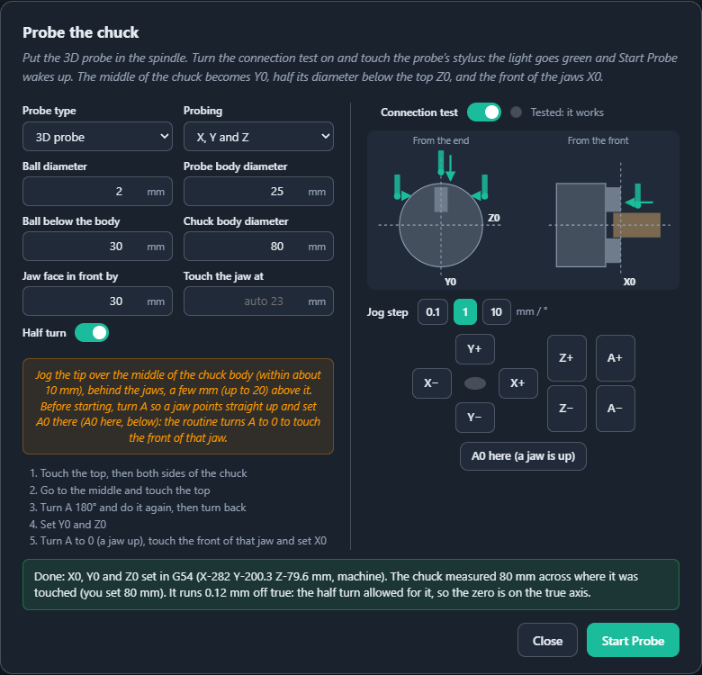

## Rotary CAM 0.12.0 (beta)

Simultaneous 4th-axis CAM inside ncSender: open an STL or STEP part, rough and finish it around the A axis, clean up what the rotary passes can't reach with indexed passes, simulate it against the stock, and load the G-code straight into ncSender. Install it from ncSender › Settings › Plugins, or with the ZIP below (Install Plugin); updates show there as *Update available*. New to it? Read the [manual](https://github.com/stmoha/ncsender-plugin-rotary-cam/blob/main/MANUAL.md) before the first carve, and air-cut the first program on a new setup.

Probe the chuck: both sides, the top, then the front of a jaw. X0, Y0 and Z0 in one go.

**New in 0.12.0**
- **Probe the chuck for the work zero.** *Work zero* has a new **Probe the chuck…** button. It opens a dialog laid out like ncSender’s own probe dialog: settings on the left, the connection test, a picture of what gets touched and a jog pad on the right, **Start Probe** at the bottom. Use a 3D probe, or the bit with a clip (the chuck wired to the probe input). It touches both sides of the chuck body and goes to the middle (Y0), touches the top there (Z0 is half the chuck’s diameter below it), then turns A to 0 and touches the front of the jaw that’s up (X0). **Probing** sets all three, Y and Z, or any one on its own, the way ncSender’s dialog lets you pick the axes.
  - **Measure the chuck body with calipers** (the round part behind the jaws, not the jaws) and type it in: Z0 depends on it. Afterwards it says what the chuck measured where it touched, and warns if that’s well off what you typed.
  - **Set A0 with a jaw straight up first** (the **A0 here** button does it): the X touch turns A to 0 and touches the front of that jaw.
  - **Half turn** (on by default) touches the chuck again with A turned 180° and takes the average. A chuck that doesn’t run true still gives the true axis, and it tells you how far off true it runs.
  - It works out how far down beside the chuck the collet nut (or the probe’s body) lets the tip go. Each touch is ncSender’s own: fast, back off, slow. Every move to and from the chuck stops if it touches something, with a message saying what to change. An alarm turns **Start Probe** into **Unlock**.
  - The rotary zero for tool changes follows the new zero, and the controller goes back to the units it was in.
  - **The first time, watch it with a hand on Stop.** It only moves the machine and sets the zero; it doesn’t change any toolpaths. Probed with a 3D probe, measure the cutter’s length the way you do after probing in ncSender, or zero Z with the first tool.
- *Work zero — from a corner of the rotary* is still there, under the probing, for a rotary that comes off the table and goes back.

**Since 0.2.0**
- 0.11.6: cutting past the rotary axis only where it’s needed; finishing and Indexed take any end mill; stepovers as a length or a %; Simulate shows parts open down the middle; Size the stock to fit the part
- 0.11.5: checks for stock that’s too thin or too short name the field and set it; Part starts at X includes the chuck end tenon; Parting cuts the tenons
- 0.11.4: a stock exactly as thick as *Part needs at least* no longer shows in red
- 0.11.3: with Tenons › *Chuck end only*, only the chuck tenon’s sizes show
- 0.11.2: the fine print on first open (and from the **beta** badge); a **Manual** link beside the version; on wide landscape screens the checks get a column right of the view that shuts to a strip
- 0.11.1: with a tapered ball, the whole-side pass never plunges below the part; Cancel always stops; the status clock keeps ticking; writing the program is a step of its own
- 0.11.0: Indexed can finish the whole side it faces (one even pass instead of spots)
- 0.10.0: dust collection / dust boot switch (off by default); a manual (MANUAL.md)
- 0.9.9: the A+ arrow in 3D follows the A direction setting
- 0.9.8: which way A turns is a Machine setting, with a Turn A +90° test
- 0.9.7: a program with Indexed asks which way A turns (wrong, Indexed cuts the opposite side)
- 0.9.6: progress you can follow, more cores, inch programs only with A set as rotary ($376), a note on calibrating A
- 0.9.5: the Z travel limit holds still while you shorten stickouts; what's left once every tool fits
- 0.9.4: one Z travel message with the most a tool may stick out and how to check it, stickout of the tool in the spindle, one stickout per tool number, stock length + clamping distance, live centre total length, the chuck end and tailstock end fade when they're in the way, silver / dark gray setup
- 0.9.3: Z not zeroed on the axis yet (or not homed) no longer blocks Generate
- 0.9.2: open windows pick up changes made on another computer before generating, loading or saving
- 0.9.1: programs stay inside the Z travel, stock at a glance in the header, version and update badge, settings that survive reopening and two computers
- 0.9.0: Indexed planning around 7× faster (own exact ball drop-cutter, drops on every worker), listed angles by default
- 0.8.0: work zero from a corner of the rotary (Move zero to the rotary axis), G-code zero marked in 3D, 4-jaw chuck, see-through spindle, tenon length
- 0.7.1: settings light up their part of the 3D setup with a dimension; headstock and tailstock reach front and back separately
- 0.7.0: collet nut, spindle and the rotary checked in every operation, per-tool stickout, tool changes routed round the rotary using ncSender's G54 / Manual Tool Changer / Safe Z, Simulate checks the holder, holder-aware Indexed angles
- 0.6.0: project files (.rcam), Indexed angles in 3D (see what each can reach, drag to change), scale / scale to fit the stock
- 0.5.0: Indexed (3+1) cleanup of what the rotary passes miss, tapered ball bits, tenons, what's left to clean shown in the simulation
- 0.4.0: Corners operation for square stock, Parting, Simulate, toolpaths that reach the ends of the part, no tool change for the same tool number
- 0.3.0: full-window layout, ncSender's units (inch fields and G20 programs), reopens where you left off, square / rectangular stock, colour-matched operation buttons, live 3D updates, tooltips, new icon
- 0.2.0: 3D view for placing the part, toolpaths drawn on the part, extra points on sharp features
